

<a href="https://github.com/differentiatorX"></a>

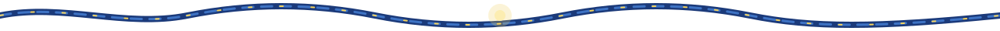

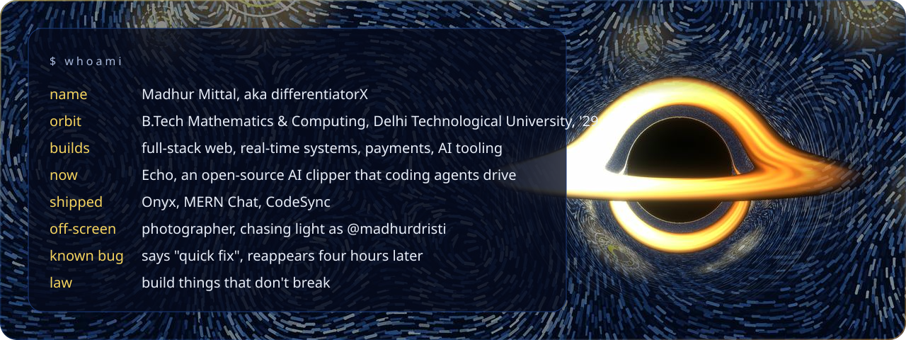

 

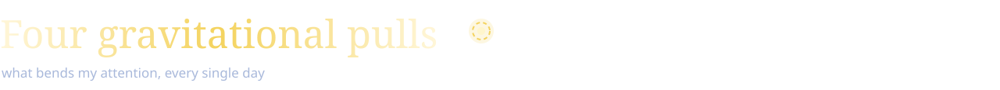



<a href="https://github.com/differentiatorX/echo">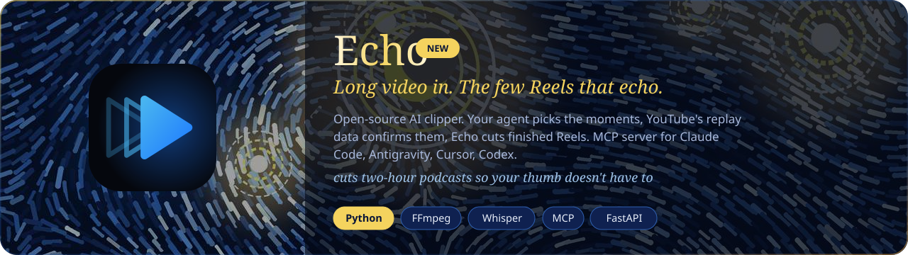</a>

<a href="https://differentiatorx.github.io/echo/"><b>Website</b></a> &nbsp;·&nbsp; <a href="https://github.com/differentiatorX/echo"><b>Code</b></a> &nbsp;·&nbsp; works with Claude Code, Antigravity, Cursor and Codex

<a href="https://github.com/differentiatorX/onyx">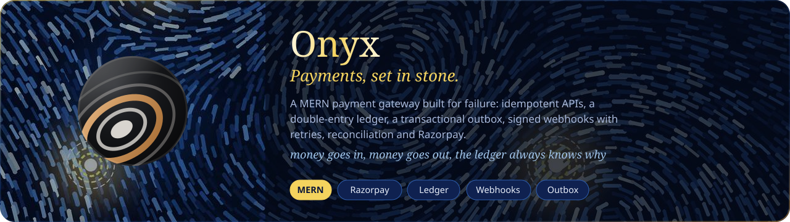</a>

<a href="https://onyx-omega-fawn.vercel.app/"><b>Live demo</b></a> &nbsp;·&nbsp; <a href="https://differentiatorx.github.io/onyx/"><b>Website</b></a> &nbsp;·&nbsp; <a href="https://github.com/differentiatorX/onyx"><b>Code</b></a>

<a href="https://github.com/differentiatorX/mern-chat"></a>

<a href="https://github.com/differentiatorX/mern-chat"><b>Code</b></a>

<a href="https://github.com/differentiatorX/CodeSync-project"></a>

<a href="https://github.com/differentiatorX/CodeSync-project"><b>Code</b></a>

<a href="https://www.instagram.com/madhurdristi">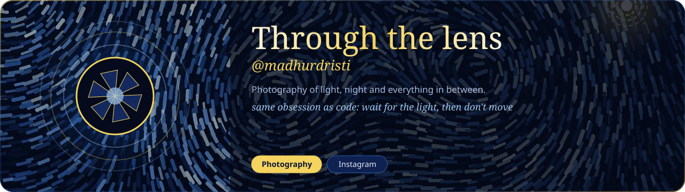</a>

<a href="https://www.instagram.com/madhurdristi"><b>See the photos</b></a>

<a href="https://github.com/differentiatorX?tab=repositories"></a>

<a href="https://github.com/differentiatorX?tab=repositories"><b>All repositories</b></a>


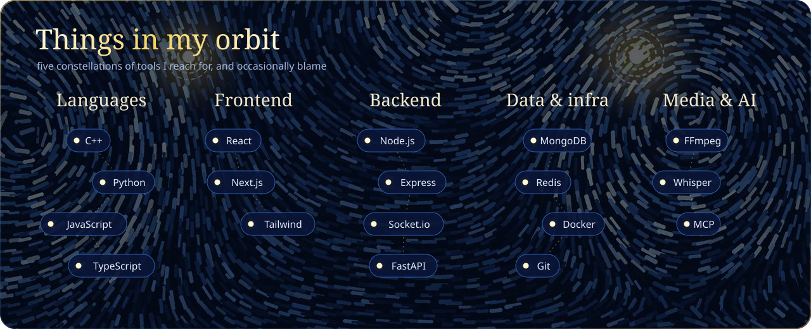


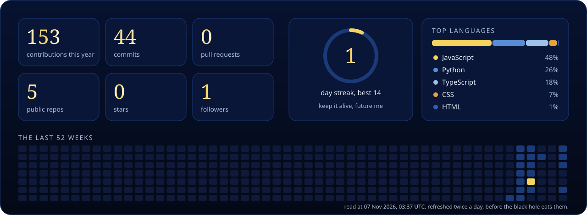



The header is a real ray trace: every pixel's light was bent around a Schwarzschild black hole, through a sky painted in the spirit of Vincent van Gogh's <i>The Starry Night</i> (1889).

