<!-- differentiatorX | Madhur Mittal -->

  

  

<!--
  Projects grid. To add a project, copy one <td> block, point the link at the repo,
  and use any image (a screenshot works). Keep two cells per row.
-->
<table>
  <tr>
    <td width="50%" valign="top">
      
      
<a href="https://onyx-omega-fawn.vercel.app/">Live demo</a> &nbsp;·&nbsp; <a href="https://differentiatorx.github.io/onyx/">Website</a> &nbsp;·&nbsp; <a href="https://github.com/differentiatorX/onyx">Code</a>

    </td>
    <td width="50%" valign="top">
      
      
<a href="https://github.com/differentiatorX/mern-chat">Code</a>

    </td>
  </tr>
  <tr>
    <td width="50%" valign="top">
      
      
<a href="https://github.com/differentiatorX/CodeSync-project">Code</a>

    </td>
    <td width="50%" valign="top">
      
      
<a href="https://github.com/differentiatorX?tab=repositories">All repositories</a>

    </td>
  </tr>
</table>

 

 

  
  
  

