

<a href="https://github.com/differentiatorX">
<picture>
  <source media="(prefers-reduced-motion: reduce)" srcset="assets/hero-still.jpg">
  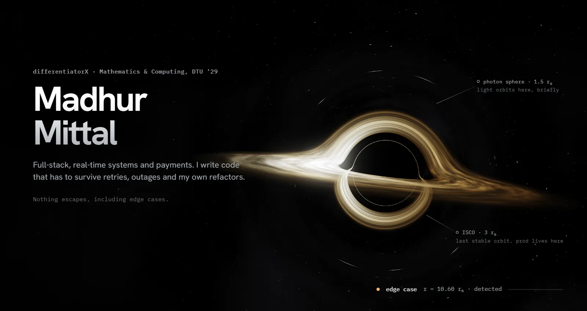
</picture>
</a>


 

 



<a href="https://github.com/differentiatorX/echo"></a>

<a href="https://differentiatorx.github.io/echo/"><b>Website</b></a> &nbsp;·&nbsp; <a href="https://github.com/differentiatorX/echo"><b>Code</b></a> &nbsp;·&nbsp; works with Claude Code, Antigravity, Cursor and Codex

<a href="https://github.com/differentiatorX/onyx"></a>

<a href="https://onyx-omega-fawn.vercel.app/"><b>Live demo</b></a> &nbsp;·&nbsp; <a href="https://differentiatorx.github.io/onyx/"><b>Website</b></a> &nbsp;·&nbsp; <a href="https://github.com/differentiatorX/onyx"><b>Code</b></a>

<a href="https://github.com/differentiatorX/mern-chat"></a>

<a href="https://github.com/differentiatorX/mern-chat"><b>Code</b></a>

<a href="https://github.com/differentiatorX/CodeSync-project"></a>

<a href="https://github.com/differentiatorX/CodeSync-project"><b>Code</b></a>

<a href="https://www.instagram.com/madhurdrishti"></a>

<a href="https://www.instagram.com/madhurdrishti"><b>See the photos</b></a>

<a href="https://github.com/differentiatorX?tab=repositories"></a>

<a href="https://github.com/differentiatorX?tab=repositories"><b>All repositories</b></a>

 


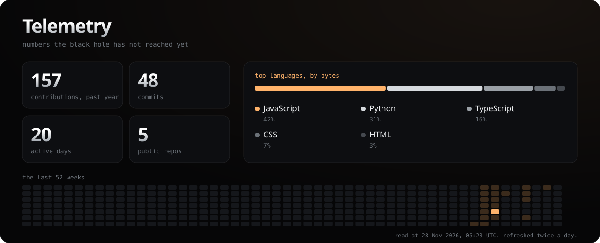


The header is rendered, not drawn: a GPU ray tracer bends every pixel's light around a Schwarzschild black hole, with Doppler beaming and gravitational redshift on the disk. The source is in <a href="render/">render/</a>.

